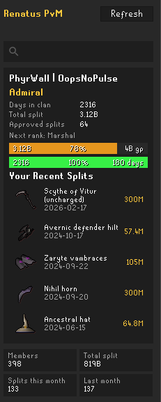
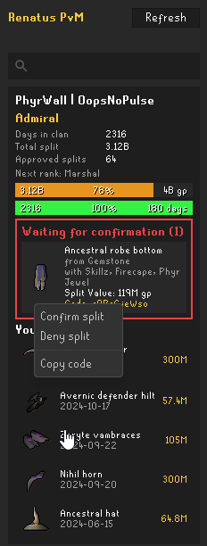
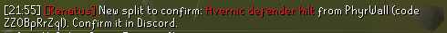

# Renatus PvM

RuneLite companion plugin for the Renatus PVM Old School Runescape clan. It reads from the clan's
website and shows:

- **Clan profile**: Rank, Days in clan, Total Approve Split GP and Progress to next rank
- **Splits waiting for your confirmation**: Splits you've been tagged in but
  haven't confirmed yet in Discord, plus a chat reminder on login
- **Confirm splits without leaving the game**: Right-click a split in the
  "Waiting for confirmation" box to confirm or deny it. It counts the same as
  clicking the button in Discord, and the split goes to staff once everyone has answered
- **New split alerts**: while you're logged in, the plugin checks every 15 minutes and
  posts a chat message & sends a notification for when someone tags you in a new split
- **Pending split info box**: an on-screen counter of splits waiting for your confirmation
- **Player lookup**: search any clan member, or click a leaderboard or recent-split row
- **Leaderboard, recent clan splits, and the rank ladder**

Submitting splits and staff approval still happen in Discord.
## Setup

1. In the [Renatus PVM Discord](https://discord.gg/renatus), run `/get-api-key`
2. In RuneLite, open the **Renatus PvM** config and:
    - Turn on **Connect to clan server** (off by default)
    - set **Clan server URL** to the clan website's address (e.g. `https://renatus-pvm.com`)
    - Paste your key into **API key**
   
**The key only works while you're an active clan member.**
## Screenshots

| Clan profile | Waiting for confirmation |
| :---: | :---: |
|  |  |

**New split alert**

